# Multi-Site Enterprise Network Lab

A two-site company network built and tested in Cisco Packet Tracer. A head office and a branch are joined over a routed link, share one internet connection, and are secured with ACLs, SSH-only management and port security.

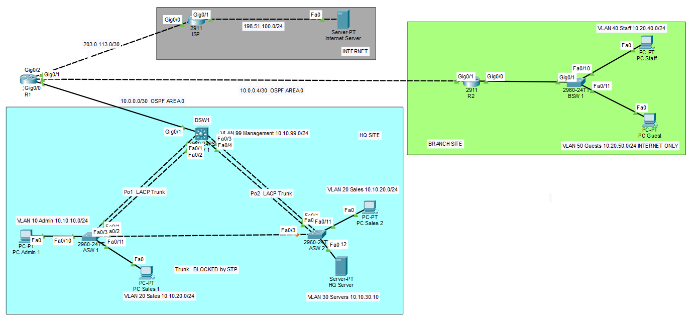

## What it demonstrates

| Area | Implementation |
|---|---|
| Switching | 6 VLANs, 802.1Q trunks, two LACP EtherChannels, PVST with a deliberate root bridge |
| Inter-VLAN routing | SVIs on a multilayer switch at HQ; router-on-a-stick at the branch |
| Dynamic routing | Single-area OSPF with passive interfaces and a propagated default route |
| IP services | Centralised DHCP server with relay from both sites; PAT for internet access |
| Security | Extended ACL isolating guests, SSH v2 limited to the Admin VLAN, port security, PortFast, BPDU Guard, unused ports shut down |

## Devices

| Device | Model | Role |
|---|---|---|
| R1 | 2911 | HQ edge router: OSPF, PAT, DHCP server, default route to the ISP |
| DSW1 | 3560-24PS | HQ distribution switch: STP root, inter-VLAN routing, DHCP relay |
| ASW1, ASW2 | 2960-24TT | HQ access switches |
| R2 | 2911 | Branch router: router-on-a-stick, DHCP relay, Guest ACL |
| BSW1 | 2960-24TT | Branch access switch |
| ISP | 2911 | Simulated internet provider with one server behind it |

## Addressing

| Network | Subnet | Gateway | Addressing |
|---|---|---|---|
| VLAN 10 Admin (HQ) | 10.10.10.0/24 | 10.10.10.1 (DSW1) | DHCP |
| VLAN 20 Sales (HQ) | 10.10.20.0/24 | 10.10.20.1 (DSW1) | DHCP |
| VLAN 30 Servers (HQ) | 10.10.30.0/24 | 10.10.30.1 (DSW1) | Static |
| VLAN 99 Management (HQ) | 10.10.99.0/24 | 10.10.99.1 (DSW1) | Static |
| VLAN 40 Staff (Branch) | 10.20.40.0/24 | 10.20.40.1 (R2) | DHCP via relay |
| VLAN 50 Guest (Branch) | 10.20.50.0/24 | 10.20.50.1 (R2) | DHCP via relay |
| DSW1 to R1 | 10.0.0.0/30 | | DSW1 .1, R1 .2 |
| R1 to R2 | 10.0.0.4/30 | | R1 .5, R2 .6 |
| R1 to ISP | 203.0.113.0/30 | | R1 .1, ISP .2 |
| Internet server | 198.51.100.0/24 | 198.51.100.1 (ISP) | Server .10 |

## Build and test results

### 1. Switching

DSW1 connects to each access switch with a two-link LACP EtherChannel. A third trunk between ASW1 and ASW2 forms a loop on purpose, so spanning tree has something to block. DSW1 is set as root bridge for every VLAN.

| Check | Result |
|---|---|
| Both bundles up with all members | 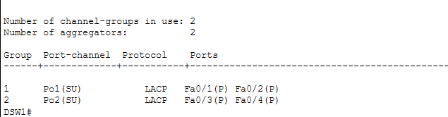 |
| Trunks carry VLANs 10, 20, 30 and 99 | 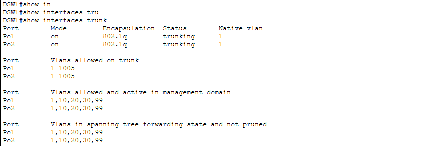 |
| ASW2 sees DSW1 as root and blocks Fa0/3 | 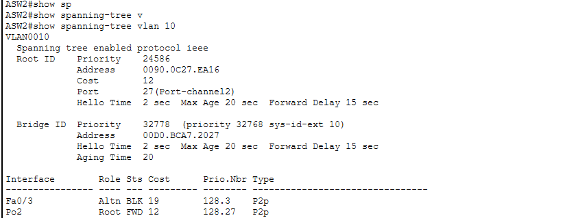 |

### 2. Inter-VLAN routing

HQ VLANs are routed by SVIs on DSW1. The branch uses 802.1Q subinterfaces on R2, so the lab shows both common methods.

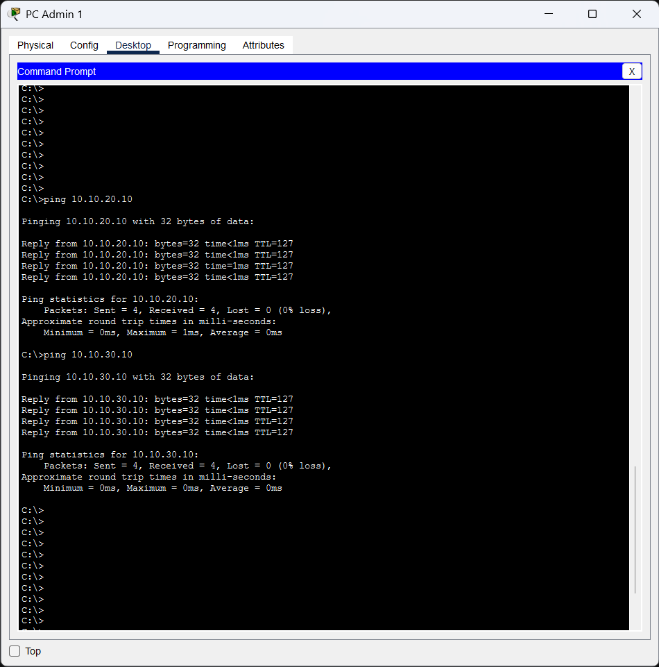

### 3. OSPF

DSW1, R1 and R2 run OSPF in area 0. User-facing interfaces are passive. R1 holds a static default route to the ISP and advertises it with `default-information originate`.

| Check | Result |
|---|---|
| R1 is fully adjacent with both neighbours | 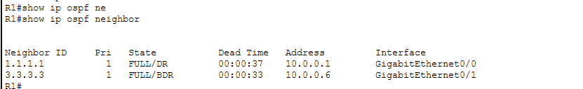 |
| DSW1 learns the branch subnets and the default route | 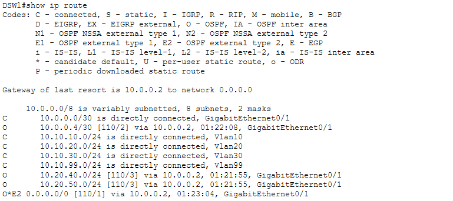 |

### 4. DHCP

R1 serves four pools. DSW1 and R2 forward client requests to it with `ip helper-address`, so branch clients get addresses from a server at another site.

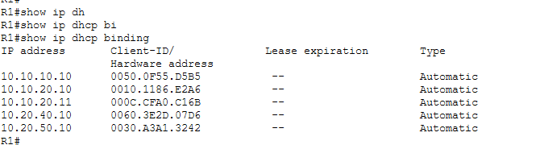

### 5. NAT

R1 translates all 10.0.0.0/8 sources to its public address with PAT. The ISP router has no routes to the private subnets, so internet access only works once NAT does.

| Check | Result |
|---|---|
| Before NAT: the internet server is unreachable | 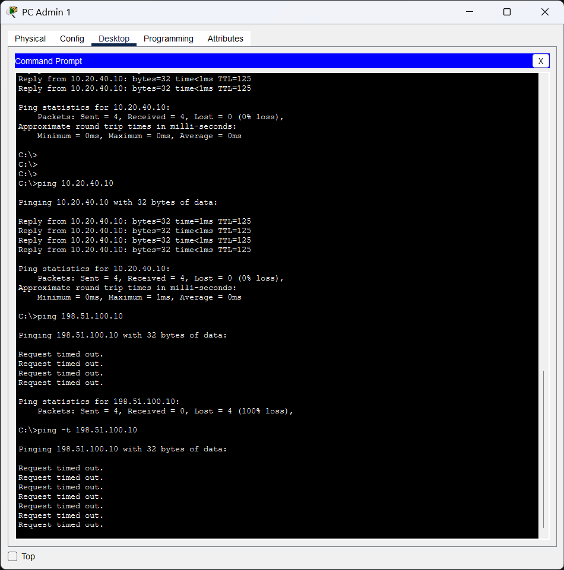 |
| After NAT: replies begin as soon as the config is applied | 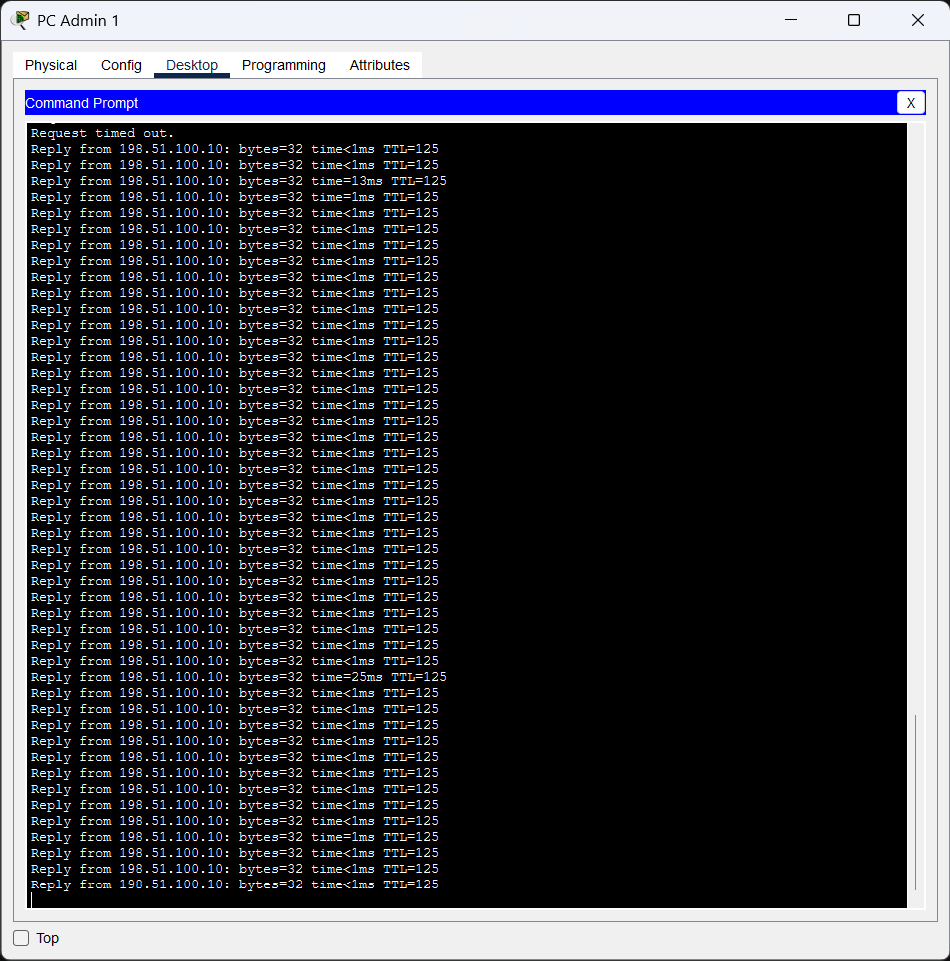 |
| Hosts from both sites share 203.0.113.1 | 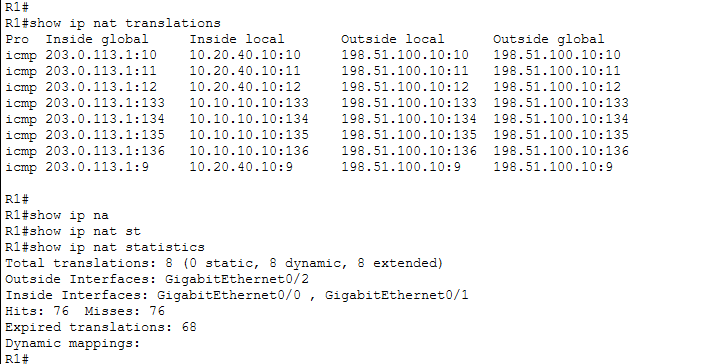 |

### 6. Security

**Guest isolation.** An extended ACL inbound on R2's guest subinterface permits DHCP, denies everything to 10.0.0.0/8 and permits the rest. Guests reach the internet but nothing internal.

| Check | Result |
|---|---|
| Guest PC: internal hosts blocked, internet reachable | 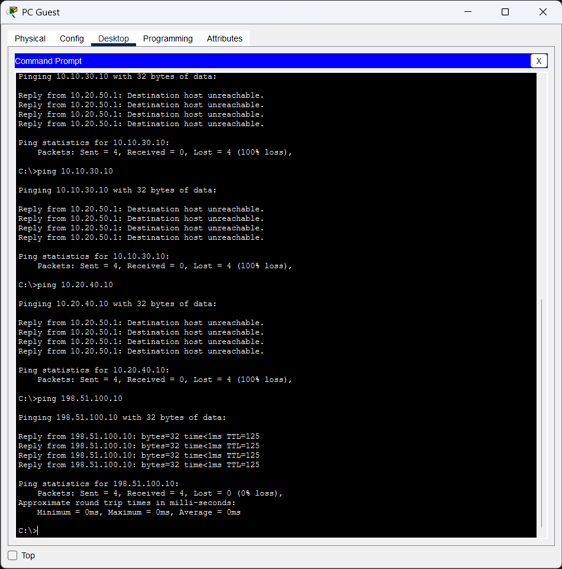 |
| Matches recorded on the deny line | 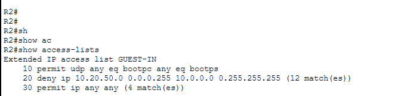 |

**Management access.** Devices accept SSH v2 only, with local user accounts, and an access class limits logins to the Admin VLAN.

| Check | Result |
|---|---|
| Login from the Admin VLAN succeeds | 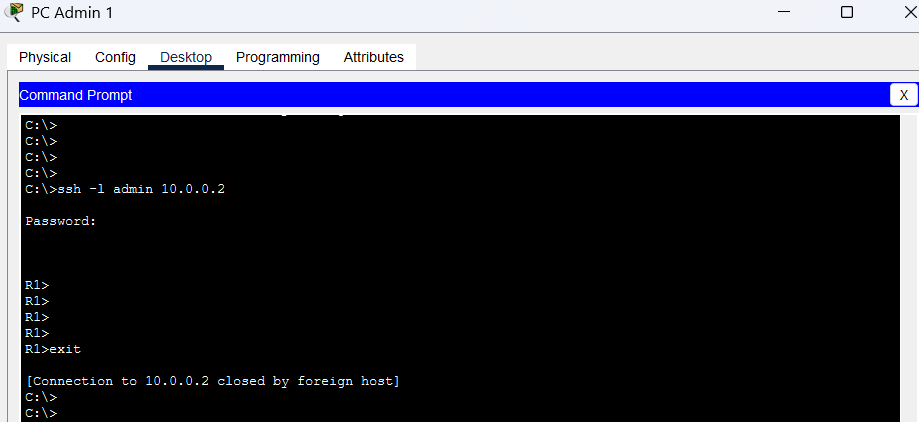 |
| Login from the Sales VLAN is refused | 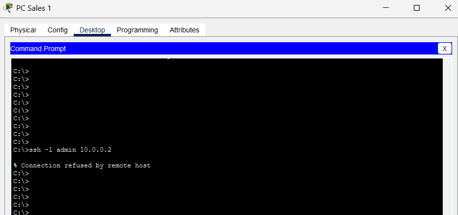 |

**Access ports.** Every user port has sticky port security with a two-address limit, PortFast and BPDU Guard. All unused ports are shut down.

| Switch | Result |
|---|---|
| ASW1 | 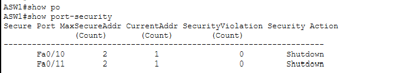 |
| ASW2 | 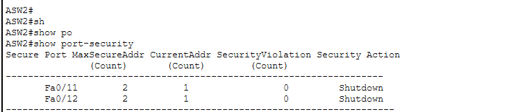 |
| BSW1 | 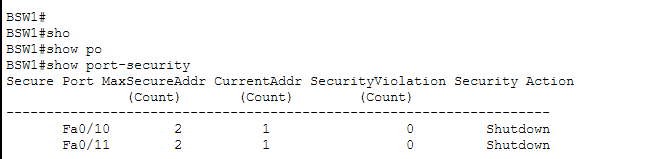 |

## Troubleshooting notes

**EtherChannel up, but no VLAN traffic.** After the SVIs were configured, PCs could not reliably ping their own gateway on DSW1, although both port-channels showed `SU` with bundled members and the trunks listed every VLAN.

- PC addressing, access-port VLANs, trunk status and the SVI configuration were each checked and found correct.
- `show spanning-tree vlan 10` on ASW2 gave the answer. It reported a root bridge with default priority 32778 reached through Fa0/3, when DSW1 (priority 24576) should have been root through Po2. DSW1's BPDUs were not arriving over the port-channels, so tagged traffic was not crossing them either. CDP still worked because it is untagged, which made the links look healthy.
- Resetting the EtherChannel bundles cleared the fault. ASW2 then showed root priority 24586 through Po2 with Fa0/3 blocked, and all pings succeeded.

**Wrong mask on a point-to-point link.** DSW1's uplink was first given a /24 mask. That would have blocked the OSPF adjacency with R1, which requires matching masks, and overlapped the R1 to R2 subnet. It was corrected to /30 before OSPF was configured.

## Known limitations

- BSW1 has no management address, so it is reachable by console only. HQ switches are managed over VLAN 99.
- The design has a single edge router and a single distribution switch, so there is no gateway or uplink redundancy.
- The ISP router and internet server only simulate an outside network.

## Repository contents

| Path | Contents |
|---|---|
| `multi-site-network.pkt` | The Packet Tracer file |
| `configs/` | Running configuration of each device, with password hashes redacted |
| `screenshots/` | Topology and test evidence |
